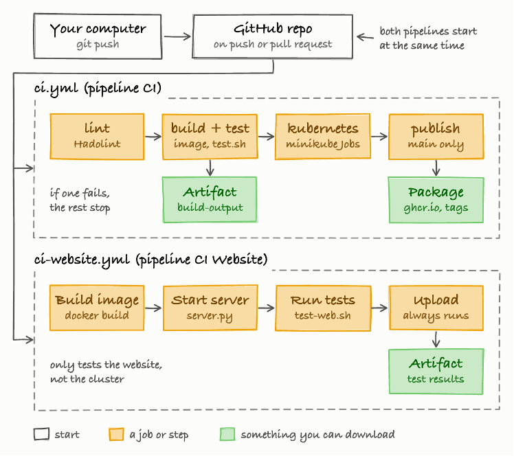

# Tasks: expo project

Let us learn how to use git, docker, kubernetes and GitHub actions.



## Level 0 - Git
1. Create a repository: in the project folder run `git init`, then `git branch -M main`.
2. Add a `.gitignore` for build output.
3. Make your first commit: `git add .` then `git commit -m "Initial commit"`. 
4. Create an empty repository on GitHub (no README), then connect it: `git remote add origin <your-repo-url>`. Check with `git remote -v`.
5. Push it: `git push -u origin main`. Refresh GitHub and confirm your files are there.
6. From now on, commit after each level: `git add .`, `git commit -m "Finish level N"`, `git push`.

## Level 1 - Docker: you need to have the expo.c file and the Dockerfile inside the folder to be able to build and run.
1. Build the image: `docker build -t expo:1.0 .`
2. Run it with `docker run --rm expo:1.0 2 10`. 
3. Run `docker run --rm expo:1.0 abc 2`. 
4. Check the image size: `docker images expo:1.0`. 
5. Build with a version: `docker build --build-arg VERSION=1.1 -t expo:1.1 .`, then run `docker inspect expo:1.1` and find the `version` label.
6. Run `bash test.sh` and make sure all tests pass.

## Level 2 - Minikube + Kubernetes: you need to have the expo.c, Dockerfile, Job.yaml files to be able to run.
1. `minikube start`, then `minikube image load expo:1.0`. It copies a Docker image from your computer into Minikube’s own image storage, so Kubernetes can use it.
2. Run the good Job: `kubectl apply -f Job.yaml`, then `kubectl logs job/expo-job`
3. If your computer is Windows and you have an invalid issue, please delete the job first `kubectl delete -f Job.yaml` and rerun the step 2.
4. Run the bad Job: `kubectl apply -f Job-bad.yaml`. Use `kubectl get jobs`. Which one shows `Failed`? expo-bad-job.
5. Read why it failed: `kubectl logs job/expo-bad-job`
6. Change the args in `Job.yaml` to `["5", "3"]`, delete the old Job `kubectl delete -f Job.yaml`, apply again.
7. Run the CronJob: `kubectl apply -f CronJob.yaml`, wait 2 minutes, then `kubectl get jobs -A`.
6. Run the CronJob: `kubectl create job expo-manual --from=cronjob/expo-cron`, `kubectl logs job/expo-manual`, then `kubectl get jobs -A`.
7. Clean up: `kubectl delete -f Job.yaml -f Job-bad.yaml -f CronJob.yaml` or `kubectl delete job expo-manual` or `kubectl delete cronjob --all`. Now check `kubectl get jobs`.

## Level 2 - Only using Kubernetes. You need these files to run this level: `expo.c`, `Dockerfile`, `Job.yaml`, `Job-bad.yaml` and `CronJob.yaml`.

1. Build the image first (from Level 1): `docker build -t expo:1.0 .`
2. Start a local Kubernetes cluster. Pick **one** option:
   - **Docker Desktop** (if minikube does not work): open Settings, then Kubernetes, tick **Enable Kubernetes**, and wait until it says it is running. Then run `kubectl config use-context docker-desktop`. You do not need to load the image.
   - **kind** (another alternative): `kind create cluster`, then `kind load docker-image expo:1.0`.
3. Check that the cluster works: `kubectl get nodes`. The node should say `Ready`.
4. Run the good Job: `kubectl apply -f Job.yaml`, then `kubectl logs job/expo-job`. You should see `2 ^ 10 = 1024`.
   - If the logs say the container is still starting (`ContainerCreating`), wait a few seconds and run the logs command again.
   - On Windows, if you get an "invalid" error, delete the Job first with `kubectl delete -f Job.yaml` and run this step again.
5. Run the bad Job: `kubectl apply -f Job-bad.yaml`. Use `kubectl get jobs`. Which one shows `Failed`? `expo-bad-job`.
6. Read why it failed: `kubectl logs job/expo-bad-job`
7. Change the args in `Job.yaml` to `["5", "3"]`, delete the old Job with `kubectl delete -f Job.yaml`, then apply it again and read the new result with `kubectl logs job/expo-job`. (A Job cannot be edited after it is created, so it must be deleted first.)
8. Run the CronJob: `kubectl apply -f CronJob.yaml`, then `kubectl get cronjob`. It creates a new Job every 10 minutes, so do not wait for it. Trigger one by hand instead:
   `kubectl create job expo-manual --from=cronjob/expo-cron`
9. Wait a few seconds, then read the result: `kubectl logs job/expo-manual`. Check all Jobs with `kubectl get jobs -A`.
10. Clean up: `kubectl delete -f Job.yaml -f Job-bad.yaml -f CronJob.yaml`, then `kubectl delete job expo-manual`. Check that nothing is left with `kubectl get jobs`.

## Level 3 - GitHub Actions: you need to have the expo.c, Dockerfile, Job.yaml, ci.yml and test.sh files to be able to run.
1. Put `ci.yml` in `.github/workflows/`. Run in your Mac terminal: `mkdir -p .github/workflows` then `cp ci.yml .github/workflows/`.
Run in your Windows terminal (PowerShell): `mkdir .github/workflows` then `Copy-Item ci.yml .github/workflows/`. Then you can commit it, and push to `main` (the repo from Level 0).
2. Open the Actions tab. Find the 4 jobs: lint, build-and-test, kubernetes-test, publish.
3. Download the `build-output` artifact and open `test-results.txt`.
4. Add a new test case to `test.sh` (for example `check "10 2" "10 ^ 2 = 100"`), commit, and push. 
5. Break it on purpose: create the branch with `git checkout -b broken`, change `pow(...)` to `base * exponent`, commit, push the branch, and watch which job fails.
6. Merge a fixed version back into `main` (`git checkout main`, `git merge broken` after fixing, or open a pull request) and check the package in the GitHub "Packages" section.

## Level 4 - Website: you need to have the expo.c, Dockerfile, Job.yaml, ci.yml, test-web.sh, index.html, ci-website.yml files to be able to run.
1. Put `ci.yml` in `.github/workflows/`. Run in your Mac terminal: `mkdir -p .github/workflows` then `cp ci.yml .github/workflows/`.
2. Put `ci-website.yml` in `.github/workflows/`. Run in your Mac terminal: `mkdir -p .github/workflows` then `cp ci-website.yml .github/workflows/`.
3. Make sure your image is `build docker build -t expo:1.0`. Then, start the server: `python3 server.py`, and open `http://localhost:8000`.
4. Calculate `2` and `10`. Does it match `docker run --rm expo:1.0 2 10`? Yes.
5. Type `abc` as the base. Which message do you see, and where does it come from? (Hint: `expo.c`)
6. Run the website tests: start `python3 server.py` in one terminal, then run `sh test-web.sh` in another. All tests should pass.
7. Put `ci-website.yml` in `.github/workflows/`, commit and push. Open the Actions tab and find the second pipeline, `CI Website`. Does `CI Website` pass?
8. Add a new check to `test-web.sh` (for example `check "3 ^ 4" "/calculate?base=3&exponent=4" "3 ^ 4 = 81"`), commit and push. Does `CI Website` still pass?

## Setup: install the tools

You need three tools for Levels 1 and 2. Install them once, in this order.

| Tool | What it does | Used in |
|------|--------------|---------|
| **Docker** | Builds and runs the `expo` image | Level 1 |
| **kubectl** | The command-line tool that talks to Kubernetes | Level 2 |
| **minikube** | A small Kubernetes cluster on your own computer | Level 2 |

### 1. Docker Desktop

- **Mac:** `brew install --cask docker`, or download it from https://www.docker.com/products/docker-desktop/
- **Windows:** `winget install Docker.DockerDesktop`, or download it from the same page. Docker Desktop on Windows uses WSL 2. If the installer asks you to enable it, accept and restart your computer.
- **Linux:** follow https://docs.docker.com/engine/install/ for your distribution.

Open Docker Desktop and wait until it says it is running. Then check:

```
docker --version
docker run --rm hello-world
```

The second command prints "Hello from Docker!" when everything works.

### 2. kubectl

- **Mac:** `brew install kubectl`
- **Windows:** `winget install Kubernetes.kubectl`
- **Linux:** follow https://kubernetes.io/docs/tasks/tools/

Docker Desktop may already include it. Check:

```
kubectl version --client
```

### 3. minikube

- **Mac:** `brew install minikube`
- **Windows:** `winget install Kubernetes.minikube`
- **Linux:** follow https://minikube.sigs.k8s.io/docs/start/

After installing, **close your terminal and open a new one**, so the new commands are found. Then start the cluster, using Docker as the engine:

```
minikube start --driver=docker
kubectl get nodes
```

The node should say `Ready`. The first start takes a few minutes because it downloads files.

### Check that everything works

```
docker --version
kubectl version --client
minikube status
```

If all three print a version or `Running`, you are ready for Level 1.

### Common problems

- **"Cannot connect to the Docker daemon":** Docker Desktop is not running. Open it and wait until it is ready.
- **`command not found` or "not recognized":** close the terminal and open a new one. On Windows, a restart can also help.
- **`minikube start` fails:** make sure Docker Desktop is running first, then try `minikube delete` followed by `minikube start --driver=docker`.
- **Windows asks about WSL 2 or virtualization:** virtualization must be turned on in your computer's BIOS. Search for your computer model with "enable virtualization".
- **Still not working:** try the alternatives in the next section (Docker Desktop's built-in Kubernetes or kind).


## Setup: a local Kubernetes cluster (if minikube does not work on your computer)

Level 2 needs a Kubernetes cluster running on your own computer. Kubernetes normally runs on many servers, so we use a small "mini" version that runs on one machine. You only need **one** of the options below. If one does not work on your computer, try the next one.

| Option | What it is | Load the image? |
|--------|-----------|-----------------|
| **minikube** | A small cluster in a virtual machine or container | `minikube image load expo:1.0` |
| **Docker Desktop** | A cluster built into Docker Desktop (Settings, Kubernetes, Enable) | Not needed |
| **kind** | "Kubernetes in Docker": the cluster runs inside Docker containers | `kind load docker-image expo:1.0` |

### Why do we load the image?

`docker build` saves the image in your local Docker. Some clusters keep their own separate image storage and cannot see it. The load command copies the image in, so Kubernetes does not try to download `expo:1.0` from the internet and fail with `ErrImagePull`.

### Installing kind

kind needs **Docker Desktop to be open and running** (check with `docker ps`) and `kubectl` installed.

- **Mac:** `brew install kind`
- **Windows (PowerShell):** `winget install Kubernetes.kind`, then open a new PowerShell window.
- **Linux:** follow the steps at https://kind.sigs.k8s.io/docs/user/quick-start/

Check that it works:

```
kind version
kind create cluster
kubectl get nodes
```

The node should say `Ready`. The first `kind create cluster` takes a minute or two.

To remove the cluster when you finish: `kind delete cluster`.

### Common problems

- **Cannot connect to the Docker daemon:** Docker Desktop is not running. Start it and try again.
- **`kind: command not found`:** close the terminal and open a new one.
- **`ErrImagePull` or `ImagePullBackOff` on a Pod:** the image is not in the cluster. Run the load command for your option again.
- **`kubectl` talks to the wrong cluster:** check with `kubectl config current-context`. It should say `minikube`, `docker-desktop` or `kind-kind`. Change it with `kubectl config use-context <name>`.
